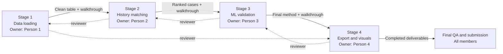

# DataWorks 2026: work plan

## Goal

Perform history matching for the reservoir realizations, select the **10 forecasts that best reproduce field history**, and submit their quarterly cumulative gas, oil, and water forecasts.

## What is provided

| Source | Contents | Use |
| --- | --- | --- |
| `01 Introduction.xlsx` | Nomenclature and uncertainty values for 100 cases | Feature definitions and case parameters |
| `02 Field Production.xlsx` | Actual field history plus production curves for cases 1–100 | History-match targets and candidate forecasts |
| `03`–`06 Train Cases` | Cases 1–70 | Training set |
| `07 Validation Cases` | Cases 71–85 | Model selection and robustness checks |
| `08 Test Cases` | Cases 86–100 | Final blind-style selection set |
| `09 Template Deliverable.xlsx` | 10 output sheets | Required submission format |

Each case has 90,365 grid cells and 29 variables: grid/coordinates, rock and flow properties, saturation endpoints, plus pressure and fluid saturations/ratios. The stated uncertainty drivers are fault transmissibility, porosity multiplier, permeability multiplier, and aquifer pore volume.

## Required output

- Preserve the supplied `09 Template Deliverable.xlsx` structure.
- Populate its 10 sheets with **80 quarterly rows**, from **1 Apr 2008 through 1 Jan 2028**.
- Required columns: cumulative gas (MSCF), oil (STB), and water (STB).
- Curves must be non-decreasing, start from a consistent historical base, and remain physically plausible.

## Recommended approach

1. **Build a clean curve table.** Parse the six production sheets in `02 Field Production.xlsx`; align every case to common quarterly dates. Use the observed field history from Jan 1998 to Jan 2008 (41 observations) as the calibration window.
2. **Score history match.** Compare each candidate curve with historical oil, gas, and water rates/cumulatives. Use normalized error per fluid, with higher weight on oil and gas unless the evaluation guidance says otherwise. Penalize impossible cumulative behavior.
3. **Use the case grids only where they add value.** Start with curve-based matching as the reliable baseline. If using ML, compress the 3D grids into stable case-level features (statistics by property/region, pore-volume-weighted measures, connectivity proxies, and the four stated uncertainty drivers), then predict curve descriptors or match score rather than the full 80-step curve directly.
4. **Validate honestly.** Train/tune on cases 1–70; use cases 71–85 for feature/model choices. Keep cases 86–100 out of tuning. Test simple baselines: nearest historical curve, weighted ensemble, and a regularized model/boosting model. Select the method with the best validation history-match and forecast plausibility.
5. **Forecast, select, and export.** The supplied simulated curves stop at 1 Jan 2008, so they support history matching only. Generate the 2008–2028 forecast with the chosen model, select 10 distinct realizations, write only the requested cumulative columns, and check dates, units, blanks, and monotonicity.

## Deliverables to prepare

- `{team_name}.zip`: reproducible source code, environment/dependency instructions, trained model artifacts, and a short run guide.
- PowerPoint: problem, data, method, validation, selected forecasts, uncertainty/risk, and conclusion.
- Power BI dashboard sourced from the completed template workbook (version 2.154.1260.0 or earlier).
- Seven-minute public or unlisted YouTube video; upload only a text file containing its link.

## Immediate next actions

1. Create a reproducible data loader and reshape the production workbooks to one tidy table.
2. Implement the history-match score and produce a ranked plot/table of all 100 cases.
3. Establish the baseline selection, validate it on cases 71–85, then generate the completed template and dashboard/storyline.

## Four-person execution plan

Work **by stage**, with one clear owner at a time. This reduces coordination overhead. The owner writes the main code, while the next-stage owner reviews it and receives a short handover. Everyone still follows the pipeline and can run it end to end.

| Stage | Main owner | Support / reviewer | Exact output before next stage |
| --- | --- | --- | --- |
| 1. Data loading, cleaning & understanding | Person 1 | Person 2 | Reproducible loader, cleaning log, data dictionary, and clean quarterly production table |
| 2. History-match baseline | Person 2 | Person 3 | Scoring function, ranked cases, and baseline plots |
| 3. Features & ML improvement | Person 3 | Person 4 | Validated model comparison and recommended final method |
| 4. Export, QA & visualisation | Person 4 | Person 1 | Completed template, QA report, dashboard-ready data, and final charts |

Person 1 then performs the final reproducibility run. Persons 2–4 check scoring, model, and output sheets respectively before submission.

### Step-by-step sequence

1. **Kickoff together (1–2 hours).** Agree on folder structure, Python environment, Git workflow, metric definition, naming, and one shared task board. Do not alter original workbooks.
2. **Stage 1: Person 1 builds the loader and cleaning pipeline.** Person 2 reviews it, tests it on the workbooks, and receives a 15-minute walkthrough. Do not start scoring until the clean table is approved.
3. **Stage 2: Person 2 builds the baseline.** Person 3 reviews the metric/ranking and receives a walkthrough. Person 1 assists only with data issues.
4. **Stage 3: Person 3 tests ML improvements.** Person 4 reviews validation code/results and receives a walkthrough. Retain the baseline if ML does not improve validation performance.
5. **Stage 4: Person 4 exports and visualises.** Person 1 reviews template integrity and receives the final run instructions.
6. **Final review together.** Run once from a clean environment. Each owner explains their stage in five minutes; the team checks selected curves, template sheets, dashboard, deck, video, and zip file.

### Working rules

- Use one repository and short pull requests. Protect `main` and keep raw data read-only.
- No code may be merged unless a second member reviews it and the author explains it briefly during the daily sync.
- The stage owner makes the final technical decision for that stage after considering reviewer feedback.
- Each handover includes: a runnable command, expected output, known limitations, and a five-to-fifteen-minute code walkthrough.
- Keep one authoritative config for dates, scoring weights, selected cases, and output path.
- Record each experiment: inputs, split, metric, result, and decision. Do not tune on cases 86–100.
- Hold a 15-minute daily sync: blockers, latest metric, next handoff, and delivery status.

### Stage 1 data-cleaning checklist

- Preserve the original Excel files. Write cleaned data to a separate processed-data folder.
- Standardise case IDs, sheet names, column names, dates, units, and numeric types.
- Reshape the production tabs into one table with `date`, `case_id`, `fluid`, `metric`, and `value`.
- Check duplicate dates/cases, missing values, impossible negatives, mixed frequencies, and inconsistent cumulative curves.
- Do **not** blindly fill missing values or delete outliers. Flag them, keep an audit log, and use interpolation only where justified for the quarterly template dates.
- Confirm cumulative production never falls; investigate any decline rather than silently correcting it.

## Risks to resolve early

- The README labels the test set inconsistently; follow the deck: **70 train, 15 validation, 15 test**.
- The deck says to “pick the best 10 forecast cases”; confirm the competition portal’s scoring rule before assuming a generic ML forecast metric.
- The six supplied simulated production-curve sheets end at the history cutoff (1 Jan 2008). Future template values are not supplied and require a documented forecast model.
- README and deck show different submission timing for some items. Treat the portal as authoritative.
- Do not publish the supplied data or challenge materials externally.
